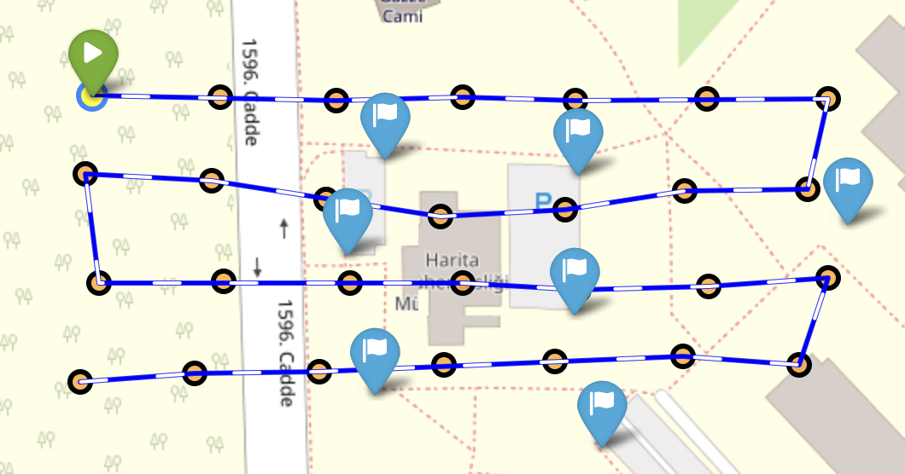
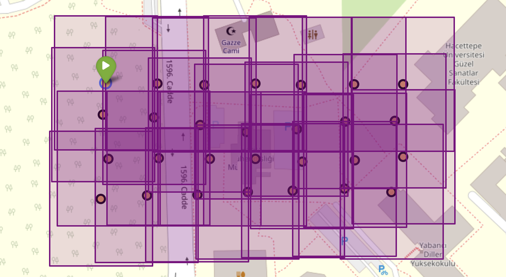
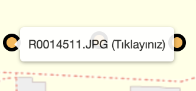
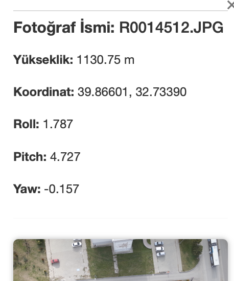
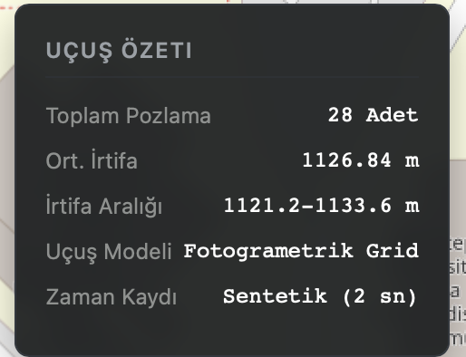
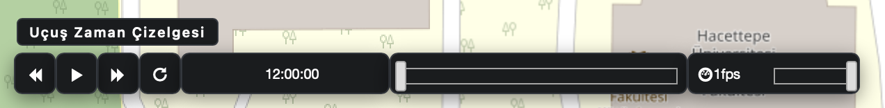
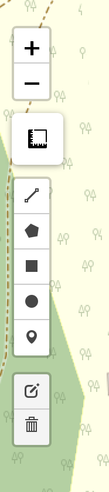
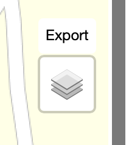
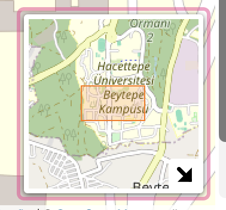

# UAV Flight Data Analysis & Interactive WebGIS Dashboard

An interactive, web-based geospatial decision support dashboard designed to analyze, visualize, and simulate UAV flight telemetry and photogrammetric survey missions. 

This project transforms raw flight logs (GPS/IMU) and sequential aerial exposures into an intuitive mission control platform, featuring real-time flight playback, orientation angles, dynamic telemetry popups, and photogrammetric footprint overlaps.

---

## Interface & Key Features

### Flight Trajectory & Photogrammetric Overlap (Footprints)
Plots the complete mission route with directional markers, capture points, and computed ground footprint polygons to inspect coverage and forward/side overlaps.

<p align="center">
  
  
</p>

- **Mission Waypoints:** Interactive vector path highlighting exposure locations, capture order, and heading direction.
- **Footprint Coverage:** Bounding polygon layers displaying the spatial coverage and overlap of each aerial photo frame.

---

### Telemetry Inspection & Mission Summary
Clicking on any exposure point triggers detailed telemetry inspection cards alongside overall mission statistics.

<p align="center">
  
  
  
</p>

- **Exposure Popups:** Real-time access to camera altitude, GPS coordinates, spatial orientation parameters (**Roll, Pitch, Yaw**), and high-resolution aerial photo previews.
- **Flight Summary HUD:** Live dashboard panel reporting total exposure count, average flight altitude, altitude ranges, and flight model classification.

---

### Timeline Simulation & Spatial GIS Controls
Interactive playback controls simulate the flight mission along with full GIS navigation utilities.

<p align="center">
  
</p>

<p align="center">
  
  &nbsp;&nbsp;&nbsp;&nbsp;&nbsp;&nbsp;&nbsp;&nbsp;
  
  &nbsp;&nbsp;&nbsp;&nbsp;&nbsp;&nbsp;&nbsp;&nbsp;
  
</p>

- **Timeline Media Player:** Play, pause, scrub, and adjust playback speed (fps) to replay the mission trajectory chronologically.
- **GIS Measurement & Vector Tools:** On-screen distance, area measurement, and vector geometry annotation tools.
- **Layer & Overview Controls:** Toggleable layer manager, spatial data export option, and synchronized overview mini-map.

---

## Tech Stack & Architecture

- **Python 3.x:** Core backend pipeline for flight log ingestion, spatial coordinate transformation, and map compilation.
- **Pandas:** Tabular data processing, timestamp sorting, and statistical telemetry evaluation.
- **Folium & Leaflet.js:** Dynamic tile rendering, custom layer control, vector styling, and GIS plugin integration.
- **HTML5 / CSS3 / Jinja2:** Fully custom dark-mode mission dashboard HUD, custom control widgets, and modal popups overriding default Leaflet UI.

---

## Dataset

The demonstration dataset is derived from a photogrammetric grid flight executed over the **Hacettepe University Beytepe Campus**.
- **Spatial Positioning:** Synchronized GNSS recordings ($X, Y, Z$ / Latitude, Longitude, Ellipsoidal Height).
- **Attitude / IMU Telemetry:** Angular orientation logs ($\omega, \phi, \kappa$ mapped to Roll, Pitch, Yaw).
- **Sensor:** Calibrated onboard camera exposures matching flight timestamp logs.

---

## Getting Started

### Clone the Showcase Repository
```bash
git clone [https://github.com/glzrygt/iha-webgis-dashboard.git](https://github.com/glzrygt/iha-webgis-dashboard.git)
cd iha-webgis-dashboard

### Author
Developed by Gülüzar Yiğit